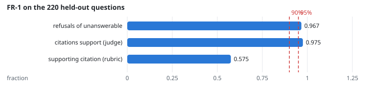
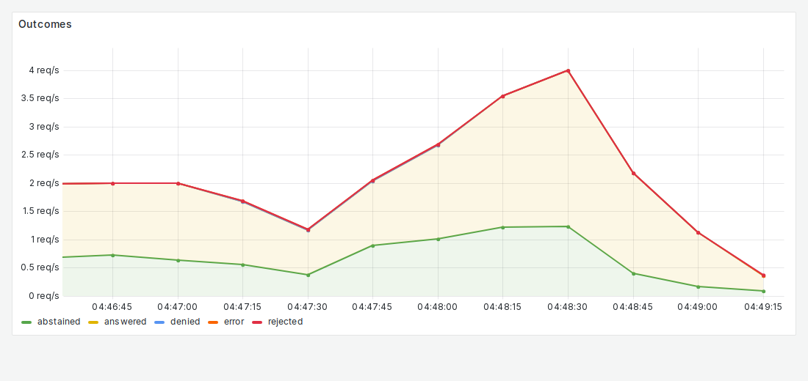

# FR-1: Cited answers, honest refusals

**Target:** ≥ 95% of answers cited correctly; ≥ 90% refusals of unanswerable questions  
**Result:** unanswerable questions refused **96.7%**; answers whose citations support them (judge) **97.5%**  
**Verdict:** pass

## Workload

`quality`: every one of the 220 held-out v2 questions once, each asked as its own test user (answerable, unanswerable, permission and revision items), 4 users without think time. The answers are graded by the rubric and by the LLM judge.

**Why it tests FR-1:** It asks questions with known answers and questions nothing in the corpus answers, and records every answer with its citations, so both halves of FR-1 are counted over the whole set.

**Command:**
```bash
sbatch slurm/loadtest.sh quality
sbatch slurm/run.sh uv run python -m eval.grader.rubric $R/answers.json $STATE $R/grade $MEASUREMENTS
sbatch --export=ALL,MODEL=granite-3.3-8b-instruct slurm/llm_job.sh uv run python -m eval.grader.judge $R/answers.json $STATE $R/grade $MEASUREMENTS
```

## Evidence

**FR-1 on the 220 held-out questions**



**Grafana: Outcomes**



## Source files

- `/data4/muthangiv/askiisc/results/locust/1596-quality/answers.json`
- `/data4/muthangiv/askiisc/results/locust/1596-quality/grade`
