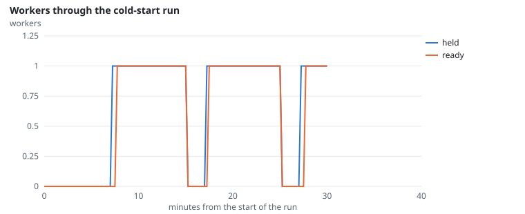
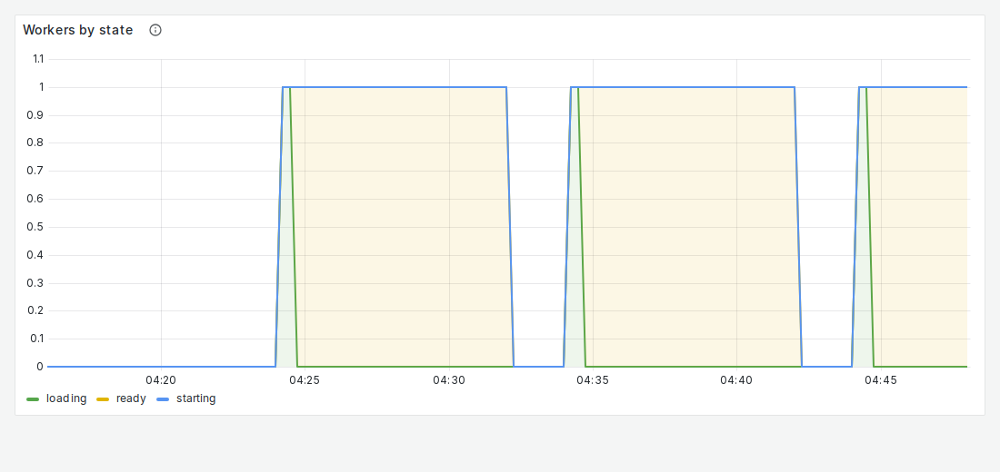
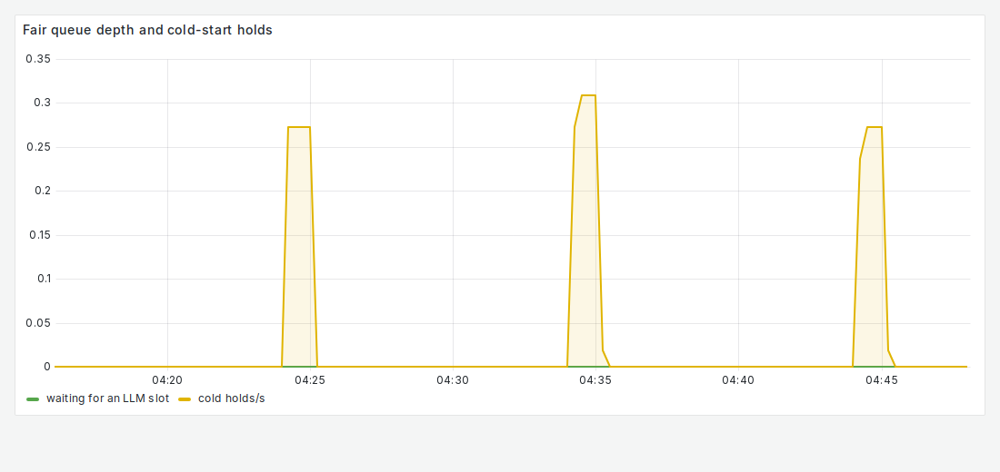

# FR-10: Scale to zero, hold the first request

**Target:** no worker 60 s after the idle timeout; requests arriving at zero workers are held and answered  
**Result:** **47** requests held through cold starts, **0** failures  
**Verdict:** pass

## Workload

`cold-start`: no traffic past the 5-minute idle timeout (the pool goes to zero), then a burst of 20 users; repeated.

**Why it tests FR-10:** Every request that arrives with no worker must wait for one to start and then be answered.

**Command:**
```bash
sbatch slurm/loadtest.sh cold-start
```

## Evidence

**Workers through the cold-start run**



**Grafana: Workers by state**



**Grafana: Fair queue depth and cold-start holds**



## Source files

- `/data4/muthangiv/askiisc/results/locust/1593-cold-start/summary.json`
