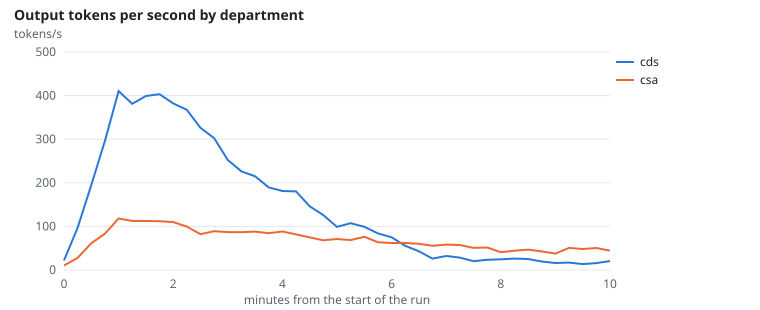
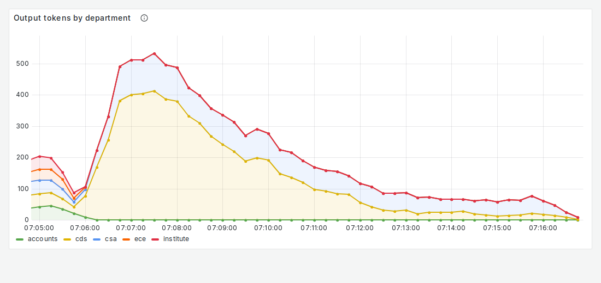
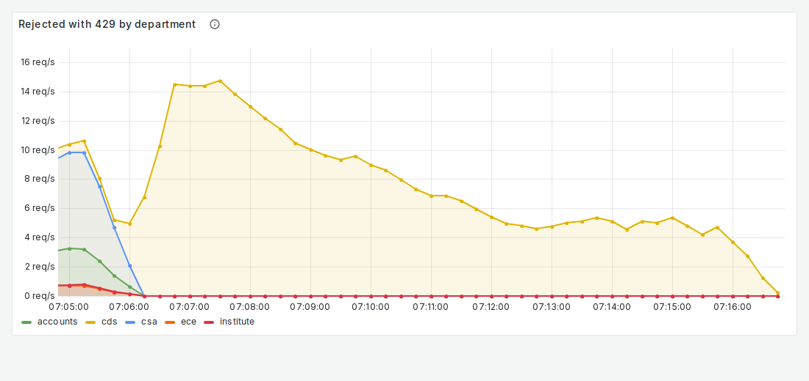

# FR-11: Fairness between departments

**Target:** with one department at 10x the load of another: the busy one ≤ 55% of tokens, the quiet one ≥ 20%  
**Result:** busy department **67.2%** of the tokens, quiet **32.8%**. The quiet department's 4 users never ask for more than about a third of the capacity, so its share is limited by its own demand  
**Verdict:** partial: quiet ≥ 20% met, busy above 55%

## Workload

`fairness`: 40 users of the busiest department and 4 of the second, all without think time, for 10 minutes.

**Why it tests FR-11:** Both departments compete for one gateway and the GPU workers; the output tokens each gets show whether the busy one crowds the quiet one out.

**Command:**
```bash
sbatch slurm/loadtest.sh fairness
```

## Evidence

**Output tokens per second by department**



**Grafana: Output tokens by department**



**Grafana: Rejected with 429 by department**



## Source files

- `/data4/muthangiv/askiisc/results/locust/1601-fairness/summary.json`
- `results/measurements/*-scaling-fairness/summary.json`
