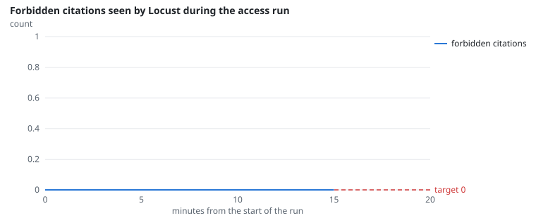
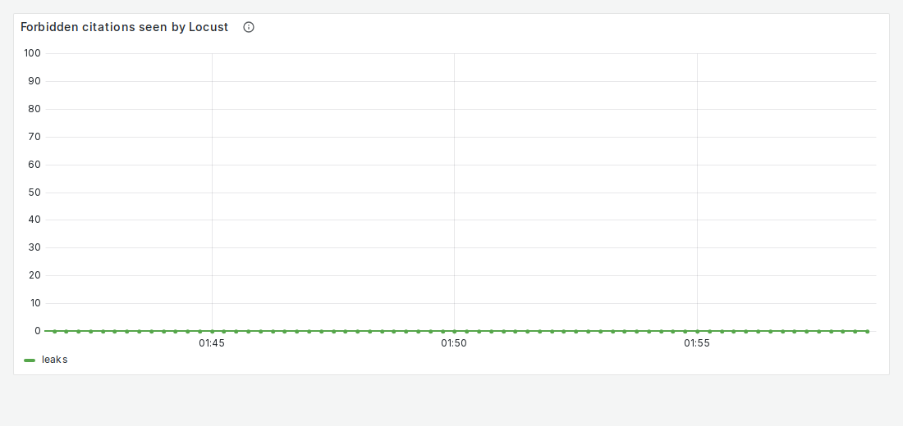
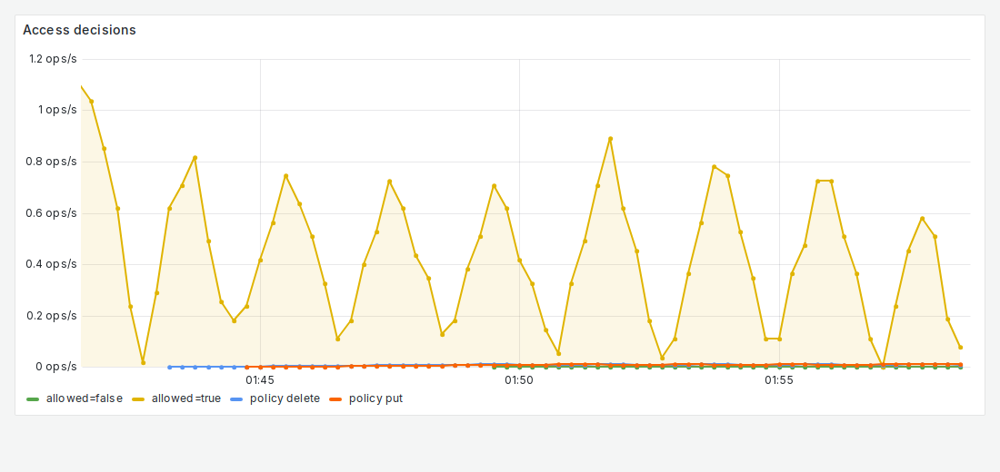

# FR-2: Filtered retrieval

**Target:** 0 forbidden chunks; recall@8 ≥ 0.95  
**Result:** **0** forbidden citations in 1,982 checked; recall@8 **1.000** over 10,000 probes, 0 leaks, search p95 19.8 ms  
**Verdict:** pass

## Workload

Two parts. `access`: 30 users of every role and department ask permission questions about restricted documents for 15 minutes; every cited document is checked against the independent oracle. The recall probe: 10,000 searches of the serving index as random users, compared with a separate brute-force search over the chunks each may read.

**Why it tests FR-2:** The Locust run catches any forbidden chunk that reaches an answer; the probe measures whether filtering inside the search loses any of the true top 8.

**Command:**
```bash
sbatch slurm/loadtest.sh access
sbatch --partition=low_2h_1gpu --mem=24G slurm/run.sh uv run python -m eval.probes.recall --state $STATE --corpus $CORPUS --users $USERS --results $MEASUREMENTS
```

## Evidence

**Forbidden citations seen by Locust during the access run**



**Grafana: Forbidden citations seen by Locust**



**Grafana: Access decisions**



## Source files

- `/data4/muthangiv/askiisc/results/locust/1558-access/summary.json`
- `results/measurements/*-recall/summary.json`
