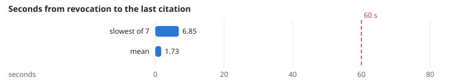
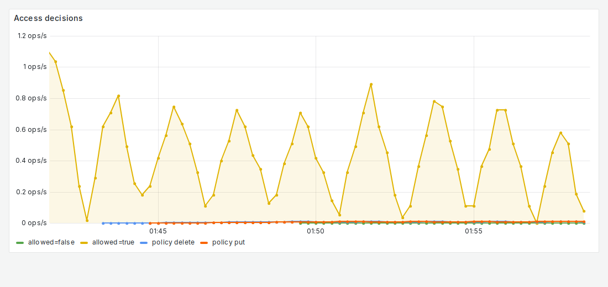

# FR-3: Per-user access, revocation

**Target:** a revoked document is no longer cited within 60 s; 0 leaks  
**Result:** 7 revocations; last citation at most **6.8 s** after (mean 1.7 s)  
**Verdict:** pass

## Workload

`access` (`RevocationUser`): an institute admin removes a restricted document's policy, a reader who could read it asks every 3 s for 90 s, and the policy is restored.

**Why it tests FR-3:** It times from the revocation to the last answer still citing the document.

**Command:**
```bash
sbatch slurm/loadtest.sh access
```

## Evidence

**Seconds from revocation to the last citation**



**Grafana: Access decisions and policy changes**



## Source files

- `/data4/muthangiv/askiisc/results/locust/1558-access/summary.json`
