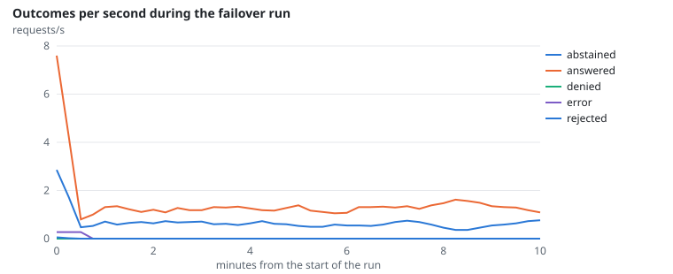
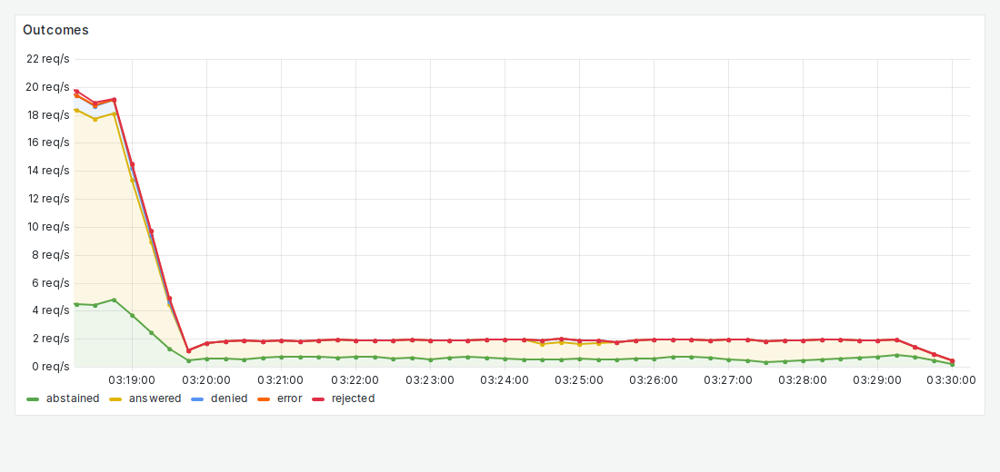
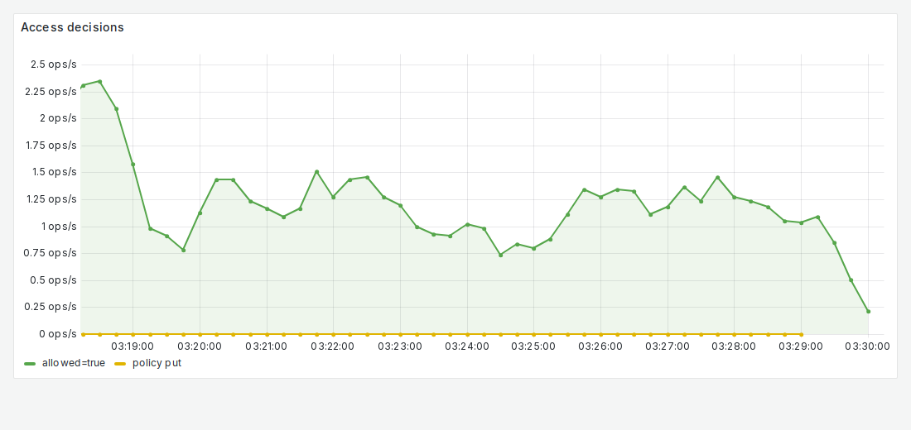

# FR-4: Separate access service, fails closed

**Target:** nothing is answered unchecked while the access service is down  
**Result:** the restart happened (1); the **14** requests during the outage were refused (403); **0** leaks  
**Verdict:** pass

## Workload

`failover`: 20 users ask temporary questions for 10 minutes; halfway, the serving job restarts the access service (fault injection, `ASKIISC_CHAOS=1`).

**Why it tests FR-4:** Requests made during the outage must be refused, never answered, and none may leak.

**Command:**
```bash
sbatch --export=ALL,ASKIISC_CHAOS=1 slurm/serve.sh
sbatch slurm/loadtest.sh failover
```

## Evidence

**Outcomes per second during the failover run**



**Grafana: Outcomes**



**Grafana: Access decisions**



## Source files

- `/data4/muthangiv/askiisc/results/locust/1584-failover/summary.json`
