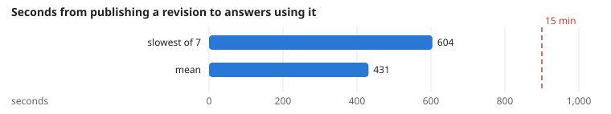
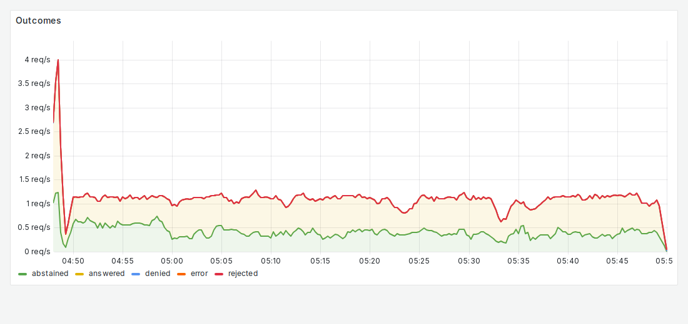

# FR-5: Versions, stale content

**Target:** answers use the current version of a revised document  
**Result:** **7 of 7** revisions answered with the new version; 0 stale  
**Verdict:** pass

## Workload

`revisions`: for an hour, an admin publishes a new revision of a test notice (a new code each time) while 10 users chat; a reader asks for the code until the answer has the new one.

**Why it tests FR-5:** Every revision must end with answers citing the new version.

**Command:**
```bash
sbatch slurm/loadtest.sh revisions
```

## Evidence

**Seconds from publishing a revision to answers using it**



**Grafana: Outcomes**



## Source files

- `/data4/muthangiv/askiisc/results/locust/1598-revisions/summary.json`
