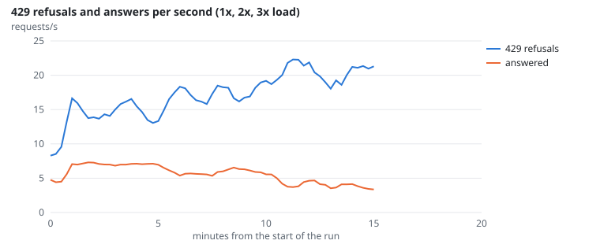
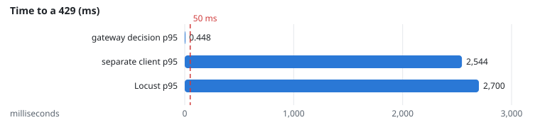
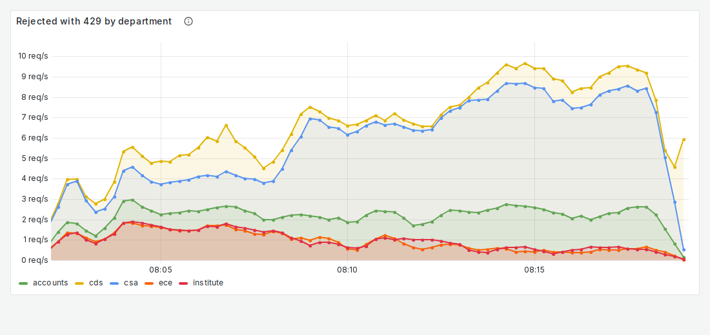
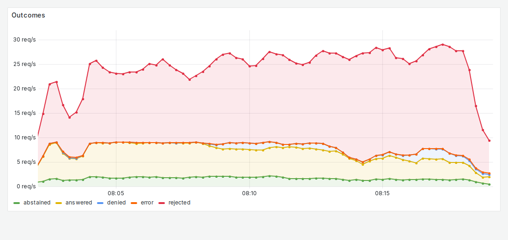

# FR-6: Load limits, 429

**Target:** at 3x load, excess requests get HTTP 429 within 50 ms  
**Result:** the gateway decides a 429 in **0.30 ms** p50 and **0.45 ms** p95 (16,025 refusals); end to end, Locust saw p95 2.7 s and the separate client p95 2.5 s: at 3x load the single gateway process is saturated before it reaches the decision  
**Verdict:** fail (end to end)

## Workload

`overload`: 5 minutes each at 32, 64 and 96 users without think time (1x, 2x, 3x); clients wait `Retry-After` after a 429. A separate light client timed its own requests during the run.

**Why it tests FR-6:** Above capacity, admission must refuse the excess quickly instead of queueing it.

**Command:**
```bash
sbatch slurm/loadtest.sh overload
```

## Evidence

**429 refusals and answers per second (1x, 2x, 3x load)**



**Time to a 429 (ms)**



**Grafana: Rejected with 429 by department**



**Grafana: Outcomes**



## Source files

- `/data4/muthangiv/askiisc/results/locust/1613-overload/summary.json`
- `requests.db (decision = rejected)`
