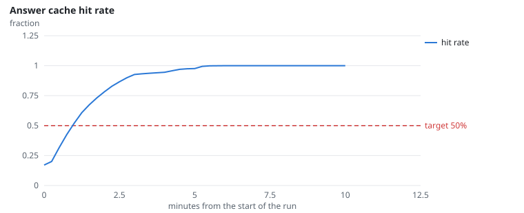
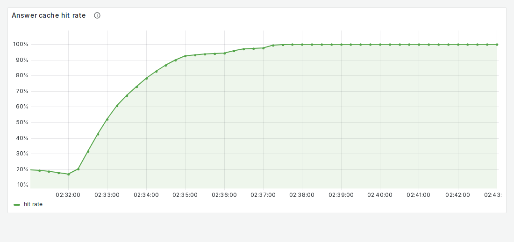
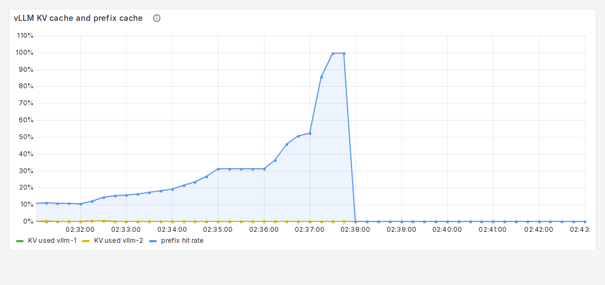

# FR-7: Batching, prefix and answer cache

**Target:** answer cache hit rate ≥ 50% on repeated questions (throughput gain from the baseline: 18.8x)  
**Result:** hit rate **98.8%**; 0 failures in 9,235 requests  
**Verdict:** pass

## Workload

`cache`: 32 users ask the same 10 popular questions again and again for 10 minutes.

**Why it tests FR-7:** Repeated questions with the same permission set must come from the answer cache.

**Command:**
```bash
sbatch slurm/loadtest.sh cache
```

## Evidence

**Answer cache hit rate**



**Grafana: Answer cache hit rate**



**Grafana: vLLM KV and prefix cache**



## Source files

- `/data4/muthangiv/askiisc/results/locust/1574-cache/summary.json`
