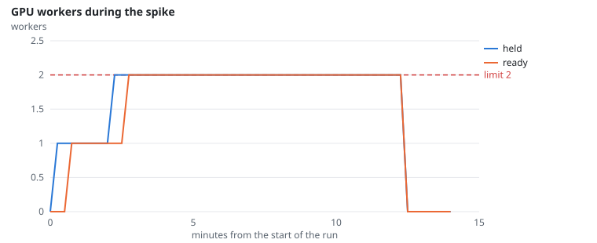
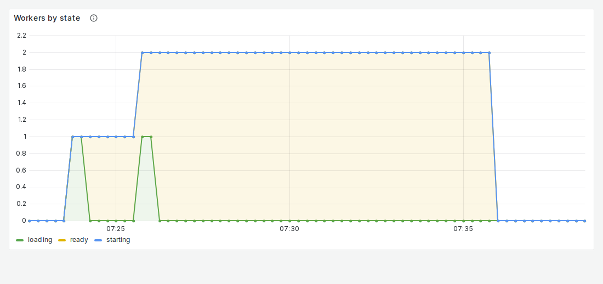
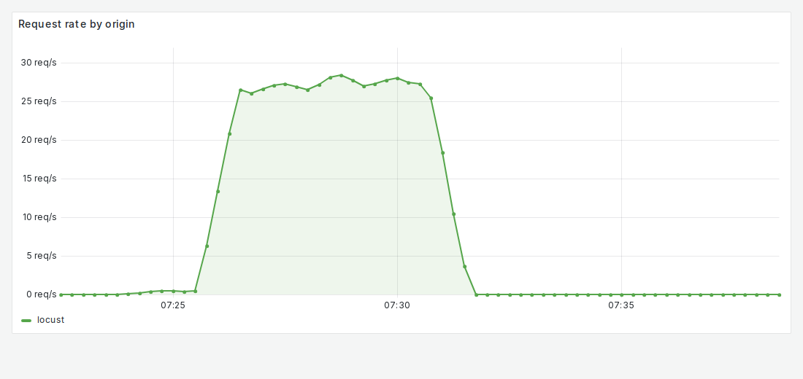

# FR-9: Scale out, at most 2 workers

**Target:** the pool reaches the needed size within 180 s and never exceeds 2 workers  
**Result:** second worker ready **30 s** after it was requested; at most **2** workers (diurnal run: 20 s)  
**Verdict:** pass

## Workload

`spike`: 5 chat users for 2 minutes, then 100 users without think time for 5 minutes, then no traffic. Started after 7 idle minutes, so the pool began with one worker.

**Why it tests FR-9:** The spike's request rate exceeds what one worker should take, so the autoscaler must add the second worker, and only one.

**Command:**
```bash
sbatch slurm/loadtest.sh spike   # then: uv run python -m eval.scaling $R/summary.json
```

## Evidence

**GPU workers during the spike**



**Grafana: Workers by state**



**Grafana: Request rate by origin**



## Source files

- `/data4/muthangiv/askiisc/results/locust/1608-spike/summary.json`
- `results/measurements/*-scaling-spike/summary.json`
