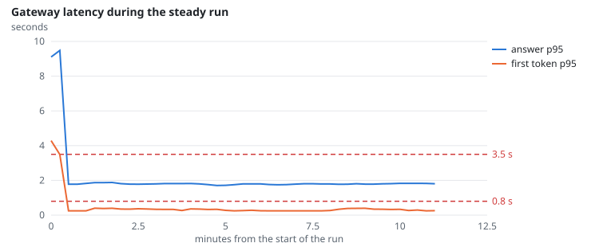
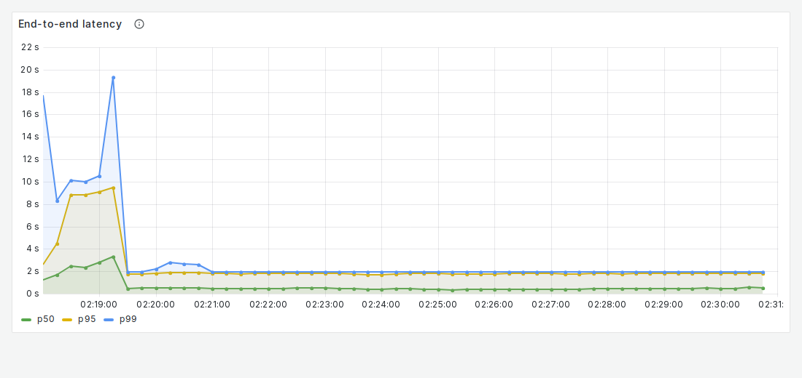
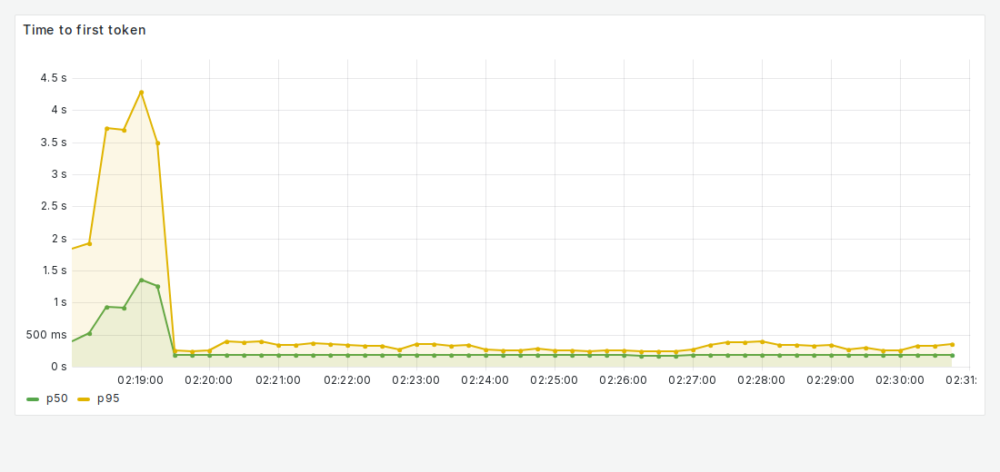

# NFR-1: Warm latency

**Target:** p95 total ≤ 3.5 s and p95 first token ≤ 0.8 s with 60 users (3 departments), at least one worker running  
**Result:** Locust p95 **1.60 s** (p50 0.49 s); first token p95 **0.35 s**; 7,780 requests, 0 failures  
**Verdict:** pass

## Workload

`steady`: ramp to 60 chat users over a minute, then 10 minutes of multi-turn chats with 5–15 s think time.

**Why it tests NFR-1:** It is the PRD's normal load; Locust measures from the client.

**Command:**
```bash
sbatch slurm/loadtest.sh steady
```

## Evidence

**Gateway latency during the steady run**



**Grafana: End-to-end latency (all web requests; the first 2 minutes are the ramp-up and a cold cache)**



**Grafana: Time to first token**



## Source files

- `/data4/muthangiv/askiisc/results/locust/1572-steady/summary.json`
- `/data4/muthangiv/askiisc/results/locust/1572-steady/report.html`
