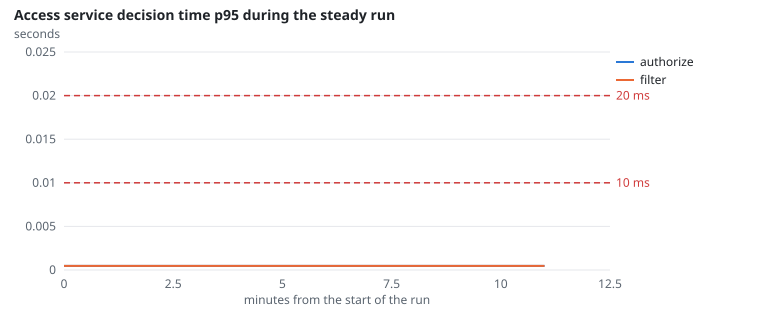
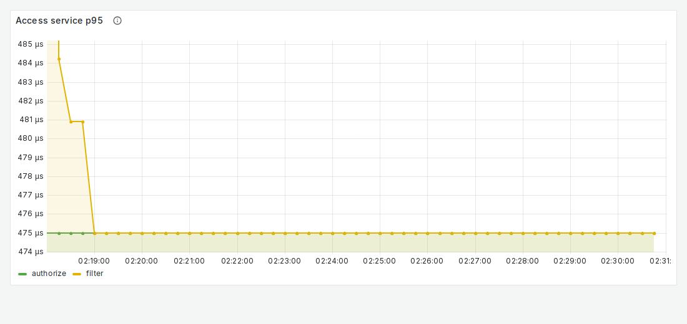

# NFR-10: Access correctness and speed

**Target:** 0 false allows; authorize ≤ 10 ms, filter ≤ 20 ms  
**Result:** 0 false allows; authorize p99 and filter p99 **< 0.5 ms** (the histogram's smallest bucket)  
**Verdict:** pass

## Workload

`access` for correctness (as for FR-2); the access service's own decision timer over the steady run for speed.

**Why it tests NFR-10:** Every citation is checked by the oracle; the timer measures each decision inside the service.

**Command:**
```bash
sbatch slurm/loadtest.sh access
sbatch slurm/loadtest.sh steady
```

## Evidence

**Access service decision time p95 during the steady run**



**Grafana: Access service p95**



## Source files

- `/data4/muthangiv/askiisc/results/locust/1558-access/summary.json`
