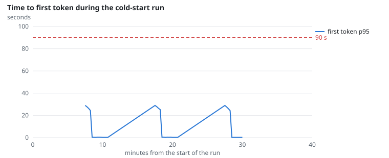
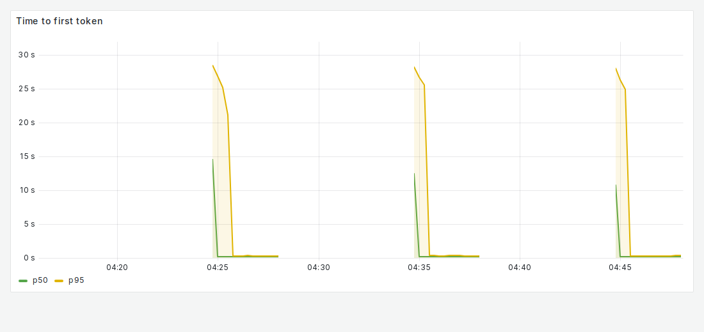
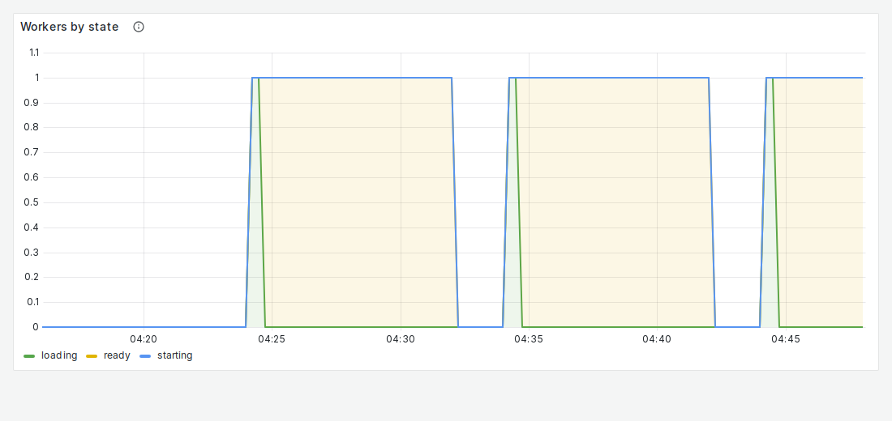

# NFR-2: Cold-start latency

**Target:** first token after a cold start ≤ 90 s (4B model)  
**Result:** slowest first token **27.9 s**  
**Verdict:** pass

## Workload

`cold-start` (as for FR-10).

**Why it tests NFR-2:** The first requests after scale-to-zero wait for vLLM to start and load the model.

**Command:**
```bash
sbatch slurm/loadtest.sh cold-start
```

## Evidence

**Time to first token during the cold-start run**



**Grafana: Time to first token**



**Grafana: Workers by state**



## Source files

- `/data4/muthangiv/askiisc/results/locust/1593-cold-start/summary.json`
