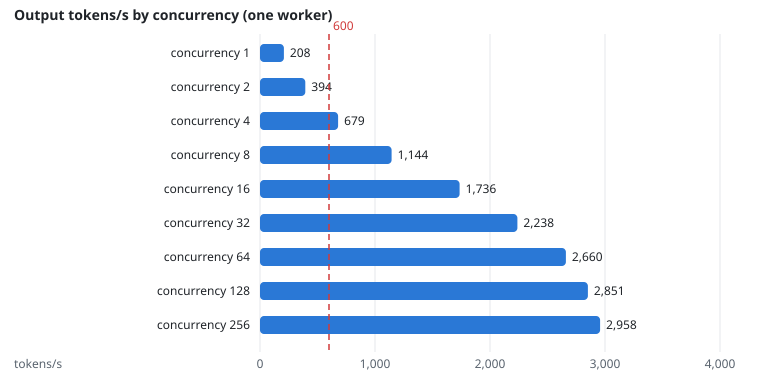

# NFR-3: Throughput per worker

**Target:** ≥ 600 output tokens/s per worker (4B model)  
**Result:** **2,660** output tokens/s at concurrency 64  
**Verdict:** pass

## Workload

`eval/llm_bench.py sweep`: the model's vLLM server alone on one H200, closed-loop clients at concurrency 1 to 256, 2 minutes each, with the gateway's real prompts.

**Why it tests NFR-3:** It finds the tokens per second one worker sustains.

**Command:**
```bash
sbatch --export=ALL,MODEL=qwen3-4b-instruct-2507 slurm/llm_job.sh uv run python -m eval.llm_bench sweep $RESULTS $STATE $OUT --measurements $MEASUREMENTS
```

## Evidence

**Output tokens/s by concurrency (one worker)**



## Source files

- `/data4/muthangiv/askiisc/results/models/qwen3-4b-instruct-2507/bench-v2/sweep.json`
