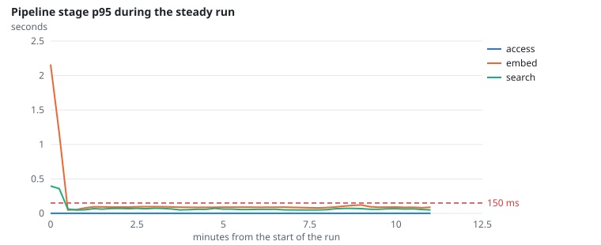
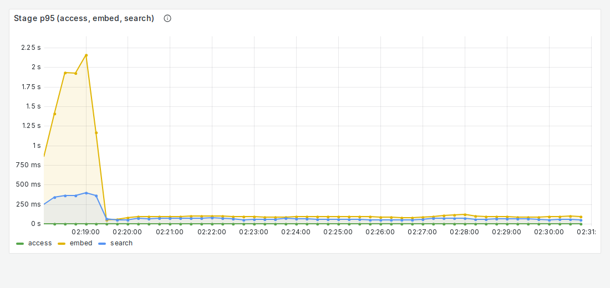

# NFR-4: Scale and elasticity

**Target:** ≤ 1% errors with 60 users per worker; search p95 ≤ 150 ms  
**Result:** 0 errors in 7,780; search p95 under load **62 ms**  
**Verdict:** pass

## Workload

`steady` (as for NFR-1); the search time comes from the gateway's stage timer over the same window.

**Why it tests NFR-4:** Errors and search time under the normal load.

**Command:**
```bash
sbatch slurm/loadtest.sh steady
```

## Evidence

**Pipeline stage p95 during the steady run**



**Grafana: Stage p95 (access, embed, search)**



## Source files

- `/data4/muthangiv/askiisc/results/locust/1572-steady/summary.json`
