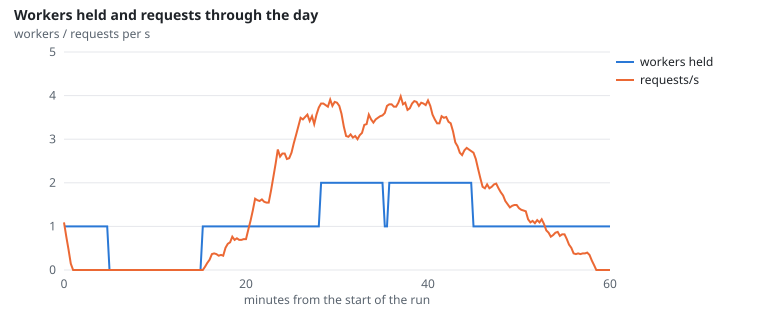
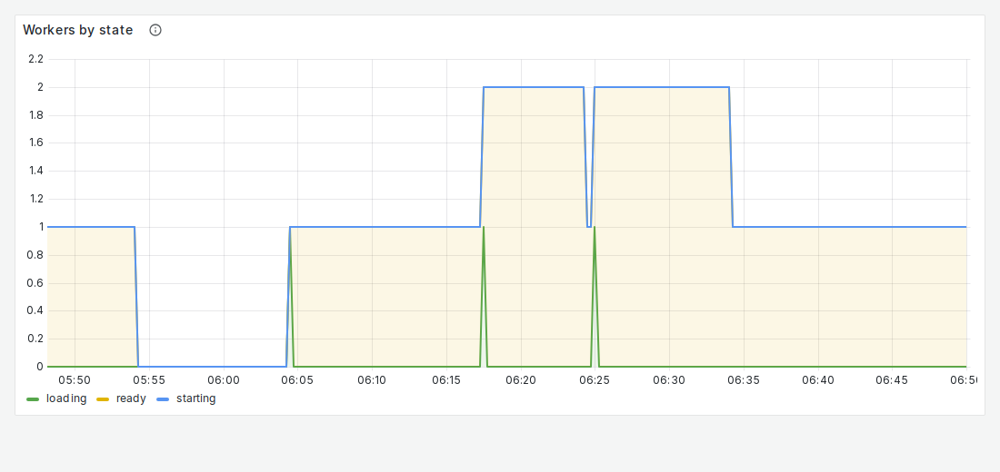
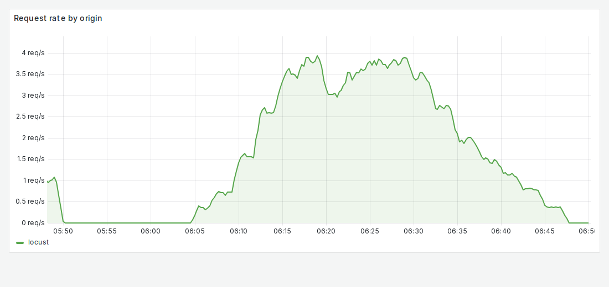

# NFR-6: Cost

**Target:** ≤ 0.30 GPU-hours per 1,000 completed queries, start-up and idle included  
**Result:** **0.19** GPU-h per 1,000 (1.10 GPU-h for 5,798 questions)  
**Verdict:** pass

## Workload

`diurnal`: a day of traffic compressed 24x into an hour (quiet nights, busy afternoons), up to 40 users.

**Why it tests NFR-6:** Scale-to-zero and scale-out over a realistic day; GPU-hours are the worker-hours Prometheus saw.

**Command:**
```bash
sbatch slurm/loadtest.sh diurnal
```

## Evidence

**Workers held and requests through the day**



**Grafana: Workers by state**



**Grafana: Request rate by origin**



## Source files

- `/data4/muthangiv/askiisc/results/locust/1599-diurnal/summary.json`
- `results/measurements/*-scaling-diurnal/summary.json`
