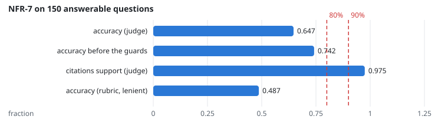
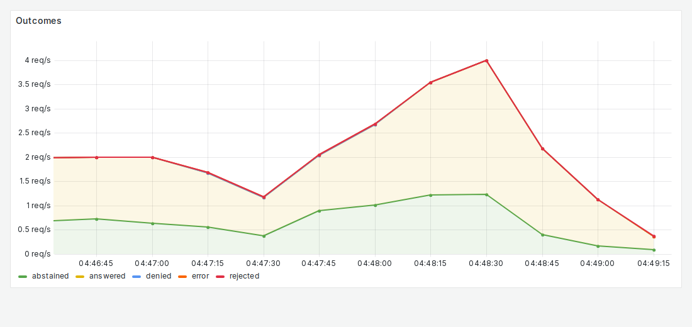

# NFR-7: Answer quality

**Target:** accuracy ≥ 80%; citation correctness ≥ 90%  
**Result:** accuracy (judge) **64.7%**, citations support (judge) **97.5%**; rubric lenient accuracy 48.7%. Before the output guards (run 1545, same questions): accuracy 74.2%, citations 95.5%: refusing uncited answers stops injections (NFR-9) but also refuses about 17 more answerable questions  
**Verdict:** fail

## Workload

`quality` (as for FR-1), graded by an LLM judge (Granite-3.3-8B, temperature 0, strict JSON) against the reference answers, and by the rubric.

**Why it tests NFR-7:** Correctness of every answerable question, and whether the cited text contains the fact.

**Command:**
```bash
(as FR-1)
```

## Evidence

**NFR-7 on 150 answerable questions**



**Grafana: Outcomes**



## Source files

- `/data4/muthangiv/askiisc/results/locust/1596-quality/grade`
