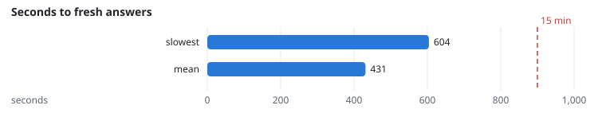
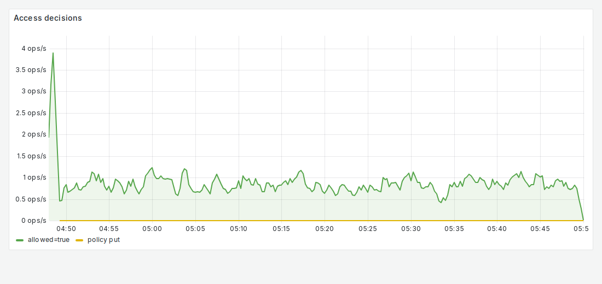

# NFR-8: Freshness

**Target:** ≥ 99% of revised documents current within 15 minutes  
**Result:** 7 of 7 current; slowest **604 s**  
**Verdict:** pass

## Workload

`revisions` (as for FR-5).

**Why it tests NFR-8:** It times every revision from publishing to the first fresh answer.

**Command:**
```bash
sbatch slurm/loadtest.sh revisions
```

## Evidence

**Seconds to fresh answers**



**Grafana: Access decisions and policy changes**



## Source files

- `/data4/muthangiv/askiisc/results/locust/1598-revisions/summary.json`
