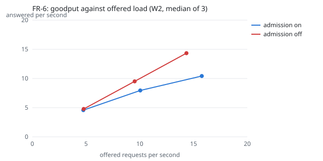

# v3 results

Compiled by `tools/v3_results.py` from raw result files only.
FR-6 job 2134; other runs job 2143. All runs used one GPU
worker on GPU 0, which other users' jobs shared at 100% use, so
latency and throughput understate an idle card (risk R-3).
Qwen3-8B-AWQ served the FR-3, FR-5, FR-6 and FR-7 runs (the card
had no room for Qwen3-8B in BF16 most of the time); NFR-1 used Qwen3-8B.

## FR-6: load shedding at 3x (E4)

Target (PRD FR-6): at 3x load, excess requests get HTTP 429 within
50 ms (judged at the serving node, decided 2026-11-05) and the p95
of accepted requests rises by at most 20% against 1x.

| Check | Target | Median of 3 (each run) | Verdict |
|---|---|---|---|
| 429 time at the node, p99 at 3x | at most 50 ms | 24.3 ms (24.3, 29.0, 24.2) | pass |
| Accepted p95, 3x against 1x | at most +20% | -4.1% (-14.0, -1.5, -4.1) | pass |

Every repetition, admission on and off (node and client times in ms):

| Arm | Rep | Load | Offered/s | Goodput/s | 429s | Node 429 p50 / p95 / p99 | Client 429 p99 | Accepted p95 (s) | Loop lag max |
|---|---|---|---|---|---|---|---|---|---|
| on | 1 | 1x | 4.64 | 4.24 | 238 | 1.1 / 2.6 / 14.0 | 75.4 | 16.6 | 134.6 |
| on | 1 | 2x | 10.21 | 8.21 | 1205 | 1.0 / 4.1 / 22.9 | 47.8 | 14.7 | 119.2 |
| on | 1 | 3x | 15.77 | 10.51 | 3156 | 1.0 / 4.2 / 24.3 | 75.3 | 14.3 | 339.4 |
| on | 2 | 1x | 4.75 | 4.58 | 103 | 1.2 / 9.3 / 20.8 | 37.0 | 14.8 | 338.8 |
| on | 2 | 2x | 10.04 | 7.95 | 1257 | 1.1 / 4.6 / 24.3 | 56.3 | 15.5 | 229.4 |
| on | 2 | 3x | 15.82 | 10.42 | 3239 | 1.0 / 5.2 / 29.0 | 90.0 | 14.6 | 157.1 |
| on | 3 | 1x | 4.90 | 4.68 | 133 | 1.1 / 5.3 / 18.3 | 24.0 | 15.4 | 159.2 |
| on | 3 | 2x | 9.94 | 7.72 | 1326 | 1.1 / 3.9 / 20.7 | 61.8 | 15.8 | 479.0 |
| on | 3 | 3x | 15.59 | 9.86 | 3435 | 1.0 / 4.2 / 24.2 | 72.1 | 14.8 | 212.6 |
| off | 1 | 1x | 4.50 | 4.50 | 0 | 0.0 / 0.0 / 0.0 | 0.0 | 18.2 | 178.3 |
| off | 1 | 2x | 9.69 | 9.69 | 0 | 0.0 / 0.0 / 0.0 | 0.0 | 18.5 | 165.4 |
| off | 1 | 3x | 14.34 | 14.34 | 0 | 0.0 / 0.0 / 0.0 | 0.0 | 20.0 | 362.8 |
| off | 2 | 1x | 4.78 | 4.78 | 0 | 0.0 / 0.0 / 0.0 | 0.0 | 14.8 | 147.4 |
| off | 2 | 2x | 9.52 | 9.51 | 0 | 0.0 / 0.0 / 0.0 | 0.0 | 18.9 | 1,489.8 |
| off | 2 | 3x | 14.21 | 14.21 | 0 | 0.0 / 0.0 / 0.0 | 0.0 | 20.2 | 384.8 |
| off | 3 | 1x | 4.89 | 4.89 | 0 | 0.0 / 0.0 / 0.0 | 0.0 | 15.7 | 167.6 |
| off | 3 | 2x | 9.42 | 9.42 | 0 | 0.0 / 0.0 / 0.0 | 0.0 | 19.6 | 182.8 |
| off | 3 | 3x | 14.48 | 14.48 | 0 | 0.0 / 0.0 / 0.0 | 0.0 | 20.9 | 395.0 |

At 3x (medians of 3): goodput 10.42/s with admission on and
14.34/s with it off (offered 14.34/s); accepted p95
14.6 s on and 20.2 s off.

**E4's collapse is not shown at this load.** With admission off
every request was answered and goodput kept up with the offered
load, so admission refused work the system could still serve.
W2 at 3x is about 15 requests/s, and W1's repeated questions are
mostly answered from the answer cache (82.2% of 55,463 answers), so the
GPU stayed below saturation. Showing the collapse needs more load than W2 3x (for
example `overload`, or W2 with the answer cache off). The FR-6
verdict (429 time and accepted p95 with admission on) does not
depend on this.



Stress diagnostic (`overload`, closed-loop users with no think time,
stack sampling on), one run per fix:

| Run | Fix | Node 429 p50 / p95 / p99 at 3x (ms) | Loop lag max (ms) |
|---|---|---|---|
| 2117 | none (before) | 689.4 / 10,914.5 / 16,027.4 | 18,094.8 |
| 2123 | audit file kept open | 10.8 / 35.3 / 62.2 | 392.3 |
| 2126 | + NFS writes off the loop | 11.0 / 38.6 / 295.6 | 323.1 |
| 2130 | + gc.freeze (server crashed 37 s before the end) | 12.2 / 39.5 / 86.6 | 191.3 |

Raw files: `/data4/muthangiv/askiisc/results/fr6/2134/<arm>/rep<k>/` (Locust, `report/fr6.json`)
and `/data4/muthangiv/askiisc/results/fr6/2134/<arm>/serve/` (`responses.jsonl`, `loop_lag.jsonl`, `audit.jsonl`).

## FR-5: freshness (E5) and FR-3: revocation (E1)

Freshness replay: not run.

Scripted revocations: not run.

Raw files: `/data4/muthangiv/askiisc/results/v3/2143/fresh/`, `/data4/muthangiv/askiisc/results/v3/2143/revocations/`.

## FR-7: prefix caching under W1 (answer cache off)

not run.

## NFR-1: latency with Qwen3-8B (`steady`, 60 users)

not run.

## NFR-2 and FR-10: 20 scripted cold starts per size (E3 c)

not run.

## FR-8: replacement models and KV-cache room at 24 GB

Smoke tests: not run.

KV-cache room at one fixed budget (`--gpu-memory-utilization 0.17`,
24 GiB of the card), decided 2026-11-05. Target: each 4-bit model
holds at least 2x its parent's KV tokens.

| Pair | Weights GiB (4-bit / parent) | KV tokens (4-bit / parent) | Ratio | Verdict |
|---|---|---|---|---|
| Qwen3-8B-AWQ against Qwen3-8B | n/a | n/a | n/a | not measured |
| Granite-3.3-8B-Instruct-GPTQ against granite-3.3-8b-instruct | n/a | n/a | n/a | not measured |
| Falcon3-7B-Instruct-AWQ against Falcon3-7B-Instruct | n/a | n/a | n/a | not measured |

Raw files: `/data4/muthangiv/askiisc/results/v3/2143/smoke/`, `/data4/muthangiv/askiisc/results/v3/2143/kv24/` (`vllm.log`).

## NFR-3: throughput sweep per model (E0)

Deferred: E0 counts only on an idle card, and GPU 0 was shared at
100% use all day (decided 2026-11-06). The last sweeps (2026-11-03,
shared card) are in `results/models/<key>/bench-<job>/sweep.json`.

## GPU memory at the start of the v3 job

```
index, utilization.gpu [%], memory.free [MiB], memory.total [MiB]
0, 100 %, 92155 MiB, 143771 MiB
1, 100 %, 1024 MiB, 143771 MiB
2, 100 %, 1024 MiB, 143771 MiB
```
